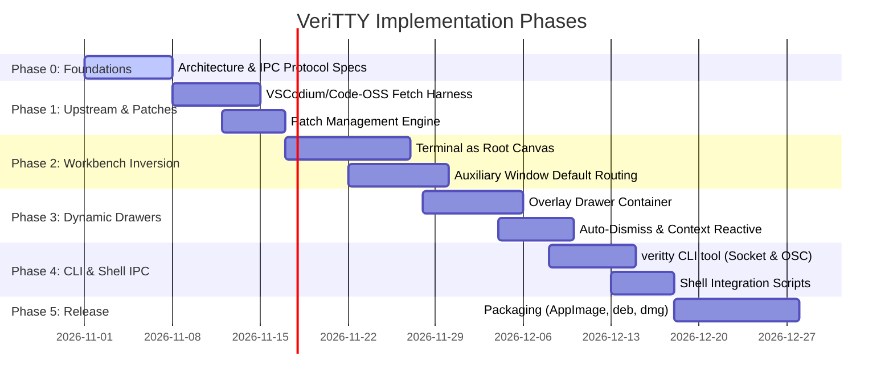

# VeriTTY Roadmap & Technical Milestones

This document details the development roadmap, architectural milestones, and implementation phases for **VeriTTY**.

---

## 🎯 Vision & Target State

VeriTTY delivers an ultra-fast, terminal-first developer cockpit:
1. **Primary Window**: Hardware-accelerated terminal multiplexer (xterm.js/PTY) occupies the central canvas.
2. **Auxiliary Windows**: Every file edit, diff view, markdown preview, or image viewer opens in a detached native OS window (`BrowserWindow` via `IAuxiliaryWindowService`).
3. **Dynamic Drawers**: Activity bar, sidebars, and panels are transformed into context-reactive floating drawers that slide in on demand and auto-dismiss.
4. **Shell IPC**: A dedicated CLI tool (`veritty`) communicates via Unix domain sockets / named pipes and OSC escape sequences.
5. **Debloated Core**: Zero telemetry, no proprietary hooks, minimal baseline memory.

---

## 📅 Milestones

---

### Phase 0: Architecture & IPC Protocol Specification (Completed)
- [x] Repository initialization & open-source governance (MIT).
- [x] Project manifesto & architecture overview ([`README.md`](file:///root/projects/veritty/README.md)).
- [x] Detailed IPC Protocol Specification ([`docs/architecture/ipc-protocol.md`](file:///root/projects/veritty/docs/architecture/ipc-protocol.md)).
- [x] Workbench Inversion Specification ([`docs/architecture/workbench-inversion.md`](file:///root/projects/veritty/docs/architecture/workbench-inversion.md)).
- [x] Dynamic Drawer System Specification ([`docs/architecture/dynamic-drawers.md`](file:///root/projects/veritty/docs/architecture/dynamic-drawers.md)).

---

### Phase 1: Upstream Base & Patch Engine (Completed)
- [x] **Upstream Base Harness**:
  - Script to pin and shallow-clone upstream Code-OSS or VSCodium source release ([`build/fetch-base.sh`](file:///root/projects/veritty/build/fetch-base.sh)).
  - Telemetry scrubbing & Open VSX marketplace configuration ([`patches/01-debloat/001-product-and-telemetry.patch`](file:///root/projects/veritty/patches/01-debloat/001-product-and-telemetry.patch)).
- [x] **Patch Management System**:
  - Automated patch application script ([`build/apply-patches.sh`](file:///root/projects/veritty/build/apply-patches.sh)).
  - Automated patch generation script ([`build/generate-patches.sh`](file:///root/projects/veritty/build/generate-patches.sh)) against clean upstream tag.
- [x] **Validation**:
  - All modular patches apply cleanly against Code-OSS tag 1.96.4.

---

### Phase 2: Workbench Layout Inversion (In Progress)
- [x] **Terminal Canvas as Root**:
  - Layout inverted: `PANEL_HIDDEN: false` by default, `EDITOR_HIDDEN: true` by default in main window ([`patches/02-workbench/001-terminal-root-canvas.patch`](file:///root/projects/veritty/patches/02-workbench/001-terminal-root-canvas.patch)).
  - Terminal registered as order 0 default panel container.
- [x] **Auxiliary Window Default Routing**:
  - Intercepted editor group resolution in `editorGroupFinder.ts` ([`patches/03-auxiliary/001-route-editors-to-aux-windows.patch`](file:///root/projects/veritty/patches/03-auxiliary/001-route-editors-to-aux-windows.patch)).
  - Routed main window editor requests to `createAuxiliaryEditorPart()` (native OS auxiliary windows).
  - GitHub Actions / build script verifying clean patch application and compilation.

---

### Phase 2: Workbench Layout Inversion
- [ ] **Terminal Canvas as Root**:
  - Modify `src/vs/workbench/browser/layout.ts` and `workbench.ts` to place `TerminalPart` in the central layout container.
  - Disable default central `EditorPart` layout requirement.
- [ ] **Auxiliary Window Default Routing**:
  - Intercept `IEditorService.openEditor` calls.
  - Route file opening requests directly through `IAuxiliaryWindowService.createAuxiliaryWindow`.
  - Configure window attributes: titlebar, lightweight framing, tiling window manager hints.
- [ ] **State & Session Persistence**:
  - Persist open terminal layouts and detached window states across application restarts.

---

### Phase 3: Dynamic Drawer Overlay System
- [ ] **Overlay Layout Transition**:
  - Transform `SidebarPart` and `AuxiliaryBarPart` from flex layout columns into CSS/DOM overlays with backdrop blur / drop shadows.
  - Implement smooth hardware-accelerated slide-in / slide-out animations.
- [ ] **Auto-Dismiss Engine**:
  - Event listener on terminal focus / keypress to automatically collapse active drawers.
  - Global hotkeys (`Ctrl+B`, `Ctrl+Shift+E`, `Ctrl+Shift+G`, etc.) to toggle drawers.
- [ ] **Context-Reactive Peeking**:
  - Expose API to briefly peek a drawer (e.g., diagnostics drawer on test failure, git drawer on branch change).

---

### Phase 4: `veritty` CLI & Shell Integration
- [ ] **Lightweight CLI Client (`cli/`)**:
  - Unix Domain Socket / Named Pipe client with sub-10ms execution overhead.
  - Commands:
    - `veritty open <path>[:line[:col]]`
    - `veritty diff <pathA> <pathB>`
    - `veritty drawer <toggle|open|close|peek> <name>`
    - `veritty scratch` (piped stdin to temporary detached editor)
- [ ] **Shell Integration**:
  - Out-of-the-box shell hooks for `bash`, `zsh`, and `fish`.
  - Inject OSC escape sequences for working directory sync, command tracking, and exit code reporting.
  - Custom shell prompt helpers for drawer notifications.

---

### Phase 5: Distribution & Packaging
- [ ] Multi-platform build targets:
  - Linux: AppImage, `.deb`, `.rpm`, Flatpak, Arch AUR.
  - macOS: Universal `.dmg` with native macOS window management.
  - Windows: Portable zip & installer with Windows Terminal / ConPTY support.
- [ ] Curated default settings & themes tailored for terminal-first minimalism.
- [ ] Documentation site and community release announcements.
