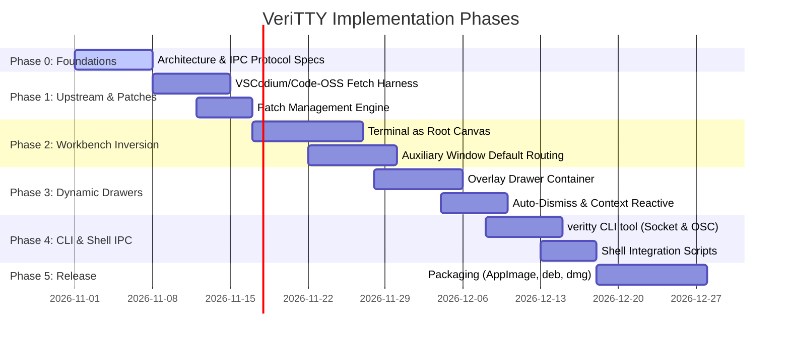

# VeriTTY Roadmap & Milestones

This document outlines the milestones and implementation phases for VeriTTY.

---

## Target State

VeriTTY configures a terminal-first workspace:
1. **Primary Window**: A terminal multiplexer (`xterm.js` and PTY) occupies the main window.
2. **Auxiliary Windows**: File edits, diffs, and previews open in detached native OS windows (`BrowserWindow` through `IAuxiliaryWindowService`).
3. **Dynamic Drawers**: File trees, git views, and diagnostics slide in as overlays and dismiss when input returns to the shell.
4. **Shell IPC**: A CLI client (`veritty`) controls windows and drawers through a local domain socket.
5. **Debloated Core**: Zero telemetry, no proprietary services, and minimal background memory overhead.

---

## Milestones

---

### Phase 0: Architecture & IPC Protocol Specification (Completed)
- [x] Repository initialization with MIT license.
- [x] Project manifesto and design specification in [`README.md`](file:///root/projects/veritty/README.md).
- [x] Socket protocol and message specification in [`docs/architecture/ipc-protocol.md`](file:///root/projects/veritty/docs/architecture/ipc-protocol.md).
- [x] Layout inversion specification in [`docs/architecture/workbench-inversion.md`](file:///root/projects/veritty/docs/architecture/workbench-inversion.md).
- [x] Dynamic drawer specification in [`docs/architecture/dynamic-drawers.md`](file:///root/projects/veritty/docs/architecture/dynamic-drawers.md).

---

### Phase 1: Upstream Base & Patch Engine (Completed)
- [x] Upstream fetch script pinning Code-OSS 1.96.4 in [`build/fetch-base.sh`](file:///root/projects/veritty/build/fetch-base.sh).
- [x] Telemetry removal and Open VSX marketplace configuration in [`patches/01-debloat/001-product-and-telemetry.patch`](file:///root/projects/veritty/patches/01-debloat/001-product-and-telemetry.patch).
- [x] Patch applicator script in [`build/apply-patches.sh`](file:///root/projects/veritty/build/apply-patches.sh).
- [x] Patch export script in [`build/generate-patches.sh`](file:///root/projects/veritty/build/generate-patches.sh).
- [x] CI verification on GitHub Actions.

---

### Phase 2: Workbench Layout Inversion (In Progress)
- [x] Invert main layout keys: `PANEL_HIDDEN: false` and `EDITOR_HIDDEN: true` in [`patches/02-workbench/001-terminal-root-canvas.patch`](file:///root/projects/veritty/patches/02-workbench/001-terminal-root-canvas.patch).
- [x] Register terminal container as default view (order 0).
- [x] Route main window editor open requests to `createAuxiliaryEditorPart()` in [`patches/03-auxiliary/001-route-editors-to-aux-windows.patch`](file:///root/projects/veritty/patches/03-auxiliary/001-route-editors-to-aux-windows.patch).
- [ ] Configure window manager hints (appId `veritty-editor`) for window tiling.
- [ ] Persist open auxiliary window geometry across restarts.

---

### Phase 3: Dynamic Drawer Overlay System (Planned)
- [ ] Render `SidebarPart` and `AuxiliaryBarPart` as absolute floating overlays.
- [ ] Dismiss drawers on terminal keystroke or canvas click.
- [ ] Add peek timeouts for diagnostics drawers on build errors.

---

### Phase 4: CLI Client & Shell Integration (Planned)
- [ ] Domain socket IPC client (`cli/`).
- [ ] Shell hooks for bash, zsh, and fish (`shell/`).
- [ ] OSC escape sequences for directory tracking and exit status markers.

---

### Phase 5: Distribution & Packaging (Planned)
- [ ] Linux binaries: AppImage, deb, tarball.
- [ ] macOS build: universal dmg.
- [ ] Release automation on merge to `main`.
